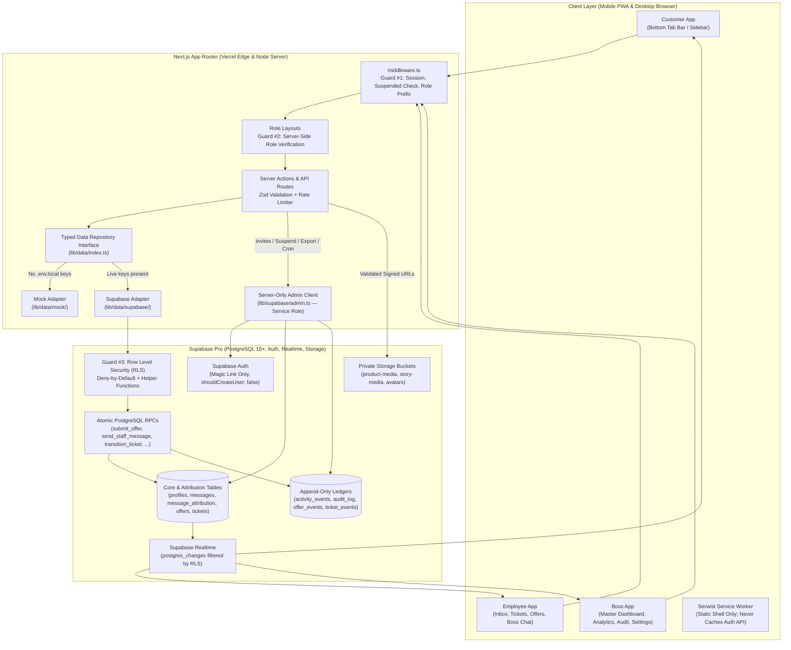

# 01 — Architecture (`docs/01-architecture.md`)

## 1. System Overview

**John Rambo** is an invitation-only, mobile-first Progressive Web App (PWA) for selling virtual game points through product inquiries and price negotiation. It supports 20 accounts at launch (1 `boss`, 4 `employee`s, 15 `customer`s) and scales cleanly to 50–60 accounts (1 `boss`, 4 `employee`s, 45–55 `customer`s).

### Architectural Priorities
1. **Security & Privacy** (PostgreSQL RLS + structural staff anonymity)
2. **Correctness** (Atomic PostgreSQL RPCs + integer paise arithmetic)
3. **Reliability** (Idempotent mutations + append-only event/audit ledgers)
4. **Maintainability** (Strict TypeScript + shared Zod schemas + typed repository interface)
5. **UX Polish** (Midnight Navy / Near-Black dark theme, Violet glow accents, Framer Motion transitions)

---

## 2. Architecture Diagram (Mermaid)

---

## 3. Core Architectural Invariants

1. **Database as the Security Boundary**: Every table in `public` has `ENABLE ROW LEVEL SECURITY` and `FORCE ROW LEVEL SECURITY` with deny-by-default policies.
2. **Mock-First Typed Repository Layer (`lib/data/`)**: UI components and Server Actions never call Supabase directly. All queries and mutations pass through `lib/data/` interfaces (`DataRepository`), backed by `MockDataRepository` (when `.env.local` has no live keys) or `SupabaseDataRepository` (when live keys exist).
3. **Triple Route Guards**:
   - **Layer 1 (`middleware.ts`)**: Verifies active session, blocks `suspended` users immediately, and enforces `/boss/*`, `/employee/*`, and customer route boundaries.
   - **Layer 2 (`app/(customer)/layout.tsx`, `app/(staff)/employee/layout.tsx`, `app/(staff)/boss/layout.tsx`)**: Server-side role verification against `profiles.role` and `profiles.status`.
   - **Layer 3 (PostgreSQL RLS & RPCs)**: Enforces row-level visibility and atomic validation inside PostgreSQL.
4. **Structural Staff Anonymity**:
   - Customers see all staff messages as **"John Rambo Support"**.
   - `public.messages` and `public.ticket_messages` store `customer_sender_id = NULL` when `sender_kind = 'staff'`.
   - The real employee ID is written atomically into `public.message_attribution` or `public.ticket_message_attribution`, which have RLS policies allowing `SELECT` exclusively to `public.is_staff()`.
5. **Service-Role Key Isolation**: `SUPABASE_SERVICE_ROLE_KEY` is imported only inside `lib/supabase/admin.ts` (guarded by `import 'server-only'`) and `scripts/seed-boss.ts`.
6. **Zero Hard Deletes & Immutable Ledgers**: `activity_events`, `audit_log`, `offer_events`, and `ticket_events` have `BEFORE UPDATE OR DELETE` triggers that raise an exception for every role.
