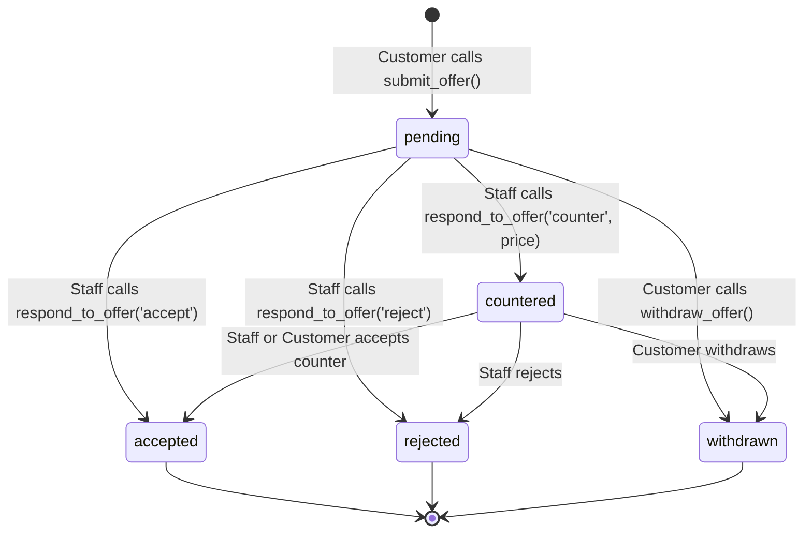
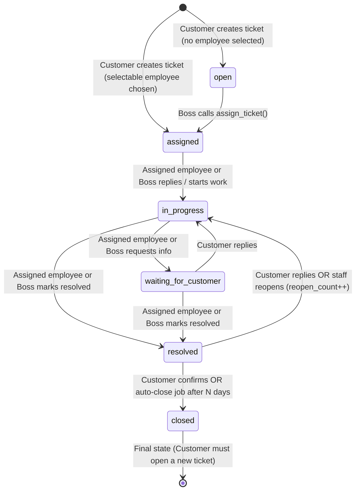

# 04 — Ticket & Messaging Logic (`docs/04-ticket-and-messaging-logic.md`)

## 1. Customer Chat & Structural Staff Anonymity

1. **One Conversation per Customer**:
   - Every customer has exactly one `conversations` row (`UNIQUE (customer_id)`), provisioned automatically when the customer profile is created.
2. **Customer Sending (`send_customer_message(p_conversation_id, p_body, p_client_msg_id)`)**:
   - Verifies caller is an active customer and owns `p_conversation_id`.
   - Enforces rate limit (max 30 messages/min) and idempotency via `(conversation_id, client_msg_id)`.
   - Inserts into `public.messages` (`sender_kind = 'customer'`, `customer_sender_id = auth.uid()`, `type = 'text'`).
   - Updates `conversations`: `awaiting_staff = true`, `last_message_at = now()`, `last_message_preview = left(p_body, 120)`, increments `staff_unread_count`.
   - Inserts `activity_events` (`event_type = 'customer_message_sent'`).
   - Creates `notifications` for the current `handled_by` employee (if set) or all active staff.
3. **Staff Sending (`send_staff_message(p_conversation_id, p_body, p_client_msg_id)`)**:
   - Verifies caller is active staff (`is_staff()`) and has scope access (`can_access_conversation(p_conversation_id)`).
   - Inserts into `public.messages` with `sender_kind = 'staff'` and **`customer_sender_id = NULL`** (so customers only see "John Rambo Support").
   - In the **same transaction**, inserts `(message_id, staff_id = auth.uid())` into `public.message_attribution`.
   - If `conversations.awaiting_staff = true`, computes `first_response_seconds` since the earliest unanswered customer message and records it in `activity_events.meta` (`event_type = 'staff_chat_reply'`).
   - Updates `conversations`: sets `handled_by = COALESCE(handled_by, auth.uid())`, `awaiting_staff = false`, `last_message_at = now()`, `last_message_preview`, increments `customer_unread_count`.
   - Notifies the customer (`notifications` row with sender `"John Rambo Support"`).

---

## 2. Price Offers & Negotiation Workflow

1. **`submit_offer(p_product_id, p_amount_paise, p_client_msg_id)`**:
   - Verifies caller is an active customer.
   - Verifies product exists and `status = 'available'`.
   - Verifies `p_amount_paise >= 100` (₹1) and `p_amount_paise <= app_settings.offer_sanity_max_paise` and `p_amount_paise <= product.price_paise * 2`.
   - Enforces rate limit (max 10 offers/hour per customer).
   - Snapshots `listed_price_paise = product.price_paise` and `product_title = product.title`.
   - Inserts `offers` row (`status = 'pending'`).
   - Inserts structured offer card message in `messages` (`type = 'offer'`, `offer_id = new_offer.id`).
   - Inserts `offer_events` (`event = 'submitted'`) and `activity_events` (`event_type = 'offer_submitted'`).
   - Updates `conversations.awaiting_staff = true` and notifies all active staff.
2. **Staff Negotiation (`respond_to_offer(p_offer_id, p_action, p_counter_paise, p_note)`)**:
   - Verifies caller is active staff with access to the offer's conversation.
   - Validates state transition (`pending` → `countered | accepted | rejected`; `countered` → `accepted | rejected`).
   - Updates `offers`: sets `status`, `counter_price_paise`, `handled_by = auth.uid()`, `updated_at = now()`.
   - Appends to `offer_events` and `activity_events` (`event_type = 'offer_' || p_action`).
   - Posts a system/offer update message into the customer's conversation and notifies the customer.

---

## 3. Support Ticket Status Machine

### Strict Transition Rules (`transition_ticket` & `reply_ticket`)
- **Illegal Transitions Rejected**: Any transition not listed in the diagram above raises a PostgreSQL exception (`INVALID_TICKET_TRANSITION`).
- **Write Authorization**:
  - `boss` can assign, reassign, reply, and transition any ticket.
  - `employee` can reply and transition **only** when `tickets.assigned_employee_id = auth.uid()`. All other active employees have read-only access to the ticket and its thread.
  - `customer` can reply to their own ticket (if not `closed`), confirm resolution (`resolved` → `closed`), or reopen (`resolved` → `in_progress`, which increments `reopen_count` and logs a `reopened` event).
- **First Response & Resolution Tracking**:
  - First staff reply on a ticket sets `tickets.first_response_at = COALESCE(first_response_at, now())` and records `first_response_seconds` in `activity_events` credited to that staff member.
  - Transitioning to `resolved` sets `tickets.resolved_at = now()` and records `resolution_seconds` (`EXTRACT(EPOCH FROM (now() - tickets.created_at))`) in `activity_events` credited to `COALESCE(tickets.assigned_employee_id, auth.uid())`.
